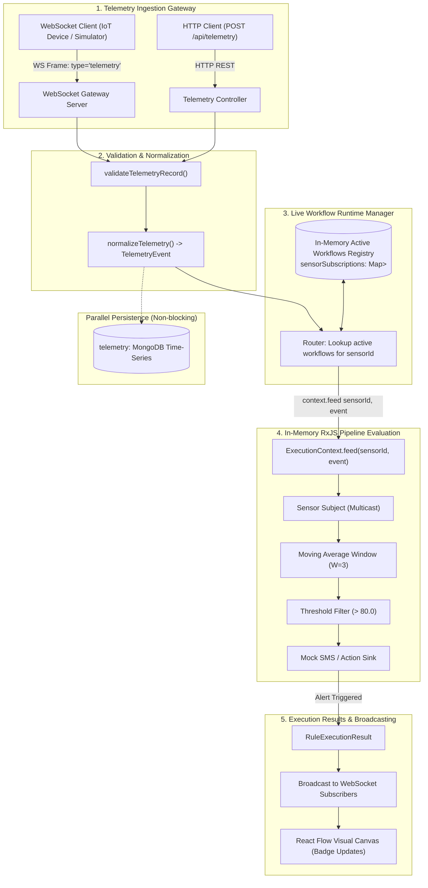

# NexusFlow: Live Execution Architecture & Integration Audit

**Project:** NexusFlow – Visual IoT Telemetry Rule Engine  
**Milestone:** Week 3, Day 1 – Live Execution Architecture & Integration Audit  
**Author / Backend Lead:** Ankit Singh (`teamleader2`)  
**Status:** Architecture Documented & Verified against Test Baseline (152/152 Passing)  

---

## 1. Executive Summary & Context

The official Week 3 backend objective is:
> **"Connect the incoming WebSocket telemetry to the dynamically compiled RxJS pipelines to evaluate rules in memory."**

During Weeks 1 and 2, the backend established:
- Express HTTP REST API and MongoDB Time-Series telemetry storage contract ([`DATABASE_INTEGRATION_CONTRACT.md`](DATABASE_INTEGRATION_CONTRACT.md)).
- High-throughput telemetry ingestion with non-blocking event-loop yields and partial-failure isolation.
- Visual Workflow persistence conforming to the frontend React Flow JSON contract ([`WORKFLOW_CONTRACT.md`](WORKFLOW_CONTRACT.md)).
- Modular Graph Parser & AST Validator with 3-color DFS DAG cycle detection and zero-`eval()` security.
- Topological Dependency Resolver (Kahn's algorithm) producing multi-stage execution plans.
- Dynamic RxJS Logic Compiler converting workflow ASTs into reactive Observable pipelines with sliding-window moving averages, threshold filters, and mock action sinks.

This audit evaluates the current integration state between the telemetry ingestion layer and the RxJS compiler, identifies the architectural gaps, and designs the end-to-end live execution engine for Week 3.

---

## 2. Current Mechanism Audit (Weeks 1–2 Baseline)

### 2.1 How Telemetry is Currently Received
Currently, telemetry enters exclusively through HTTP REST endpoints:
```
IoT Device / Client
        │
        ▼ HTTP POST
┌─────────────────────────────────────────────────────────────────────────────┐
│ Express Route: POST /api/telemetry or POST /api/telemetry/bulk             │
│   ├── 1. Body Parser: express.json({ limit: '2mb' })                        │
│   ├── 2. Validation: validateTelemetryRecord (sensorId, numeric value, etc.)│
│   ├── 3. Service: TelemetryService.ingestTelemetry(...)                     │
│   ├── 4. Repository: TelemetryRepository.insertTelemetry(...)              │
│   └── 5. Storage: MongoDB Time-Series collection ('telemetry')              │
└─────────────────────────────────────────────────────────────────────────────┘
```
- **Limitation**: Telemetry is persisted directly to MongoDB, but **no active workflow evaluation occurs**. Telemetry data and compiled workflows remain entirely decoupled.
- **WebSocket State**: No WebSocket server currently exists in `server.js` or `app.js`.

### 2.2 How the Compiled RxJS Pipeline is Currently Created
The compiler (`NexusFlowLogicCompiler` in [`backend/src/compiler/logicCompiler.js`](backend/src/compiler/logicCompiler.js)) compiles a workflow AST:
```
Workflow JSON (nodes, edges)
        │
        ▼
1. GraphDependencyResolver.resolve(workflow)
        │ ── Validates AST, detects cycles, builds topological order
        ▼
2. Instantiate ExecutionContext
        │ ── In-memory Map of Subjects (sensorId -> Subject)
        ▼
3. Map Topological Nodes to RxJS Observables
        │ ── Source nodes: context.getOrCreateSensorSubject(sensorId)
        │ ── Math nodes: pipe(createMovingAverageOperator(...))
        │ ── Threshold nodes: pipe(createThresholdOperator(...))
        │ ── Action sinks: pipe(createSmsAlertSink(...)).subscribe(...)
        ▼
4. Output: Compiled Pipeline with ExecutionContext handle
```
- **Limitation**: The compiler currently executes **in isolation** (via automated unit tests or static test sequences). Compiled pipelines are not stored in a persistent runtime registry and cannot receive live telemetry events automatically.

---

## 3. Gap Analysis: Missing Integration Points

To connect live WebSocket telemetry to compiled RxJS pipelines, four integration gaps must be addressed:

```
┌─────────────────────────────────────────────────────────────────────────────┐
│                            MISSING INTEGRATION GAPS                         │
├──────────────────────────────┬──────────────────────────────────────────────┤
│ Gap                          │ Description                                  │
├──────────────────────────────┼──────────────────────────────────────────────┤
│ 1. Telemetry Transport       │ Lack of a persistent WebSocket server on the │
│                              │ HTTP port for low-latency IoT push.          │
│ 2. In-Memory Runtime Registry│ No active lifecycle manager maintaining      │
│                              │ compiled workflow instances in memory.       │
│ 3. Workflow Routing Index    │ No sensor-to-workflow mapping index to route │
│                              │ incoming sensorId to applicable pipelines.   │
│ 4. Live Execution Outbound   │ No real-time broadcast channel to emit rule  │
│                              │ execution results / alerts back to UI/clients│
└──────────────────────────────┴──────────────────────────────────────────────┘
```

---

## 4. Live Execution Architecture Design



### Detailed Flow Explanation:
1. **Ingestion Gateway**: Ingests telemetry via WebSockets (`ws`) or HTTP REST (`/api/telemetry`).
2. **Validation & Normalization**: Validates mandatory fields (`sensorId`, finite numeric `value`) and normalizes to standard `TelemetryEvent`.
3. **Runtime Routing Index**: The `WorkflowRuntimeManager` looks up active compiled workflows subscribed to the incoming `sensorId` in $O(1)$ time via `sensorSubscriptions.get(sensorId)`.
4. **Reactive Evaluation**: For each matched active workflow, the runtime feeds the event directly into its compiled pipeline via `context.feed(sensorId, event)`.
5. **In-Memory Rule Operators**: Evaluates sliding-window rolling average (`movingAverage`) and threshold condition (`threshold`) in memory with strictly zero `eval()`.
6. **Result Outbound**: When a threshold condition triggers an action sink, a `RuleExecutionResult` event is created and broadcast over WebSocket to connected visual canvas clients.

---

## 5. Event Contracts & Schemas

To ensure seamless integration across frontend visual components, database storage, and the rule engine, existing field names are strictly reused.

### 5.1 Telemetry Event Contract (`TelemetryEvent`)
Incoming WebSocket messages and normalized internal events:
```typescript
interface TelemetryEvent {
  sensorId: string;               // Unique device identifier (e.g. "turbine-temp-01")
  value: number;                  // Numeric measurement reading (e.g. 85.5)
  unit?: string;                  // Optional measurement unit (e.g. "°C", "RPM", "PSI")
  sensorType?: string;            // Sensor classification (e.g. "temperatureSensor")
  timestamp: string;              // ISO 8601 string (e.g. "2026-11-25T16:00:00.000Z")
  location?: string;              // Physical installation sector (e.g. "Sector 4")
  metadata?: Record<string, any>; // Optional hardware attributes (e.g. boilerId, firmware)
}
```

### 5.2 Rule Execution Result Contract (`RuleExecutionResult`)
Outbound broadcast when a rule condition is satisfied:
```typescript
interface RuleExecutionResult {
  executionId: string;            // Unique execution identifier (e.g. "exec_wf1_node3_1732550400000")
  workflowId: string;             // Active workflow ID
  workflowName: string;           // Human-readable workflow title
  nodeId: string;                 // Triggering Action Sink node ID (e.g. "sms_sink")
  nodeType: string;               // Action type (e.g. "smsAlert", "webhook")
  status: 'DISPATCHED_MOCK';      // Execution status (mock alert in Week 3)
  recipient: string;              // Target notification recipient (e.g. "+15550199")
  message: string;                // Formatted emergency message
  timestamp: string;              // ISO 8601 timestamp
  sensorId: string;               // Triggering sensor identifier
  sampleValue: number;            // Current metric value triggering alert
  movingAverage?: number;         // Computed sliding-window average (if movingAverage node used)
  condition?: {
    operator: string;             // e.g. ">"
    threshold: number;            // e.g. 80.0
    actualValue: number;          // e.g. 81.67
  };
  telemetry: TelemetryEvent;      // Full triggering telemetry event snapshot
  isMock: boolean;                // Strictly true during Phase 1
}
```

### 5.3 WebSocket Client-Server Message Protocol

#### Client -> Server Frames:
| Message Type | Purpose | Payload Example |
| :--- | :--- | :--- |
| `telemetry` | Send live sensor reading | `{ "sensorId": "turbine-01", "value": 85.5, "unit": "°C" }` |
| `subscribe_workflow` | Subscribe to rule alerts for a workflow | `{ "workflowId": "wf_1795450531240_xzw21y" }` |
| `unsubscribe_workflow` | Unsubscribe from workflow events | `{ "workflowId": "wf_1795450531240_xzw21y" }` |
| `ping` | Connection heartbeat | `{}` |

#### Server -> Client Frames:
| Message Type | Purpose | Payload Example |
| :--- | :--- | :--- |
| `connected` | Acknowledge connection | `{ "connectionId": "conn_123", "serverTime": "..." }` |
| `telemetry_ack` | Acknowledge telemetry receipt | `{ "sensorId": "turbine-01", "matchedWorkflows": 1 }` |
| `rule_execution` | Broadcast alert breach | `{ ...RuleExecutionResult }` |
| `pong` | Heartbeat response | `{ "serverTime": "..." }` |
| `error` | Diagnostic error report | `{ "code": "VALIDATION_ERROR", "message": "..." }` |

---

## 6. Sensor-to-Workflow Association Strategy

### 6.1 Preserving the Frontend React Flow Contract
No modifications to the React Flow node contract are required. The association is derived directly from existing node configurations:

```json
{
  "id": "node_temp_source",
  "type": "temperatureSensor",
  "category": "dataSource",
  "config": {
    "sensorId": "turbine-temp-01"
  }
}
```
- **Identification Rule**: Any node with category `dataSource` or type matching `dataSource`, `temperatureSensor`, `humiditySensor`, `pressureSensor`, `turbineSensor`, etc., defines a stream entrypoint.
- **Sensor Extraction**: `sensorId = node.config?.sensorId || node.data?.sensorId || node.id`.

### 6.2 In-Memory Routing Index
The `WorkflowRuntimeManager` maintains a dual-map index:
```
activeWorkflows: Map<workflowId, {
  workflow: WorkflowDocument,
  compiled: CompiledPipeline,
  sensorIds: Set<string>
}>

sensorSubscriptions: Map<sensorId, Set<workflowId>>
```

**Index Maintenance Operations**:
- **On Workflow Activation / Startup**:
  1. Compile workflow graph: `compiled = compiler.compile(workflow)`.
  2. Extract all `sensorId`s from compiled sources.
  3. For each `sensorId`: add `workflowId` to `sensorSubscriptions.get(sensorId)`.
  4. Store in `activeWorkflows`.
- **On Workflow Deactivation / Deletion**:
  1. Look up `activeWorkflows.get(workflowId)`.
  2. Dispose pipeline: `compiled.dispose()`.
  3. Remove `workflowId` from all `sensorSubscriptions`.
  4. Delete from `activeWorkflows`.

---

## 7. Week 3 Implementation Roadmap

| Day | Focus | Planned Deliverables |
| :---: | :--- | :--- |
| **Day 1** | **Audit & Architecture** *(Current)* | Baseline audit (152/152 passing), gap identification, live execution architecture, event contracts, documentation. |
| **Day 2** | **WebSocket Gateway** | Lightweight `ws` server attached to Express HTTP server, connection management, frame validation, and heartbeat protocol. |
| **Day 3** | **Workflow Runtime Manager** | In-memory registry service, startup activation of active workflows, sensor-to-workflow $O(1)$ routing index. |
| **Day 4** | **Live Telemetry Dispatch** | Wire incoming WebSocket telemetry to `WorkflowRuntimeManager.dispatchTelemetry()`, feeding live events into active RxJS pipelines. |
| **Day 5** | **End-to-End Live Execution Testing** | Full integration tests: live telemetry streaming -> RxJS moving average -> threshold evaluation -> real-time alert broadcast. |

---

## 8. Baseline Audit Results

Executed full backend test suite on Node.js v22.18.0:
```
# tests 152
# suites 40
# pass 152
# fail 0
# cancelled 0
# skipped 0
# duration_ms 13190.38
```
All 152 tests across 14 test files passed with 0 failures prior to Day 1 architecture documentation.
